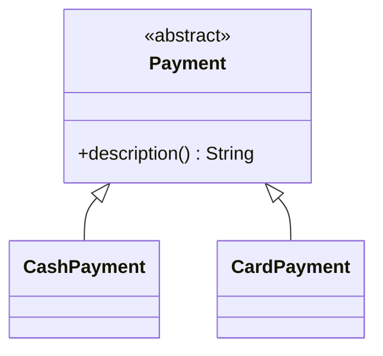

# Unit 09 · Inheritance & Polymorphism

[Course home](../README.md) · [Progress](../PROGRESS.md) · [← Previous](../08-Classes-and-Objects/README.md) · [Next →](../10-Exceptions-and-Debugging/README.md)

**Read → trace → code → test → explain**

[Source library](sources/README.md) · [Practice guide](PRACTICE.md)

[Liang Ch. 11](../00-Course-Info/sources/textbook/chapter-11-inheritance-and-polymorphism.md) · [Liang Ch. 13](../00-Course-Info/sources/textbook/chapter-13-abstract-classes-and-interfaces.md)

<details>
<summary>On this page</summary>

- [Start here: Separate declared type from runtime type](#start-here-separate-declared-type-from-runtime-type)
- [Learning outcomes](#learning-outcomes)
- [1. What is inheritance?](#1-what-is-inheritance)
- [2. `extends`](#2-extends)
- [3. What is inherited? (LO1)](#3-what-is-inherited-lo1)
- [4. Constructors and `super(...)`](#4-constructors-and-super)
- [5. Method overriding (LO2)](#5-method-overriding-lo2)
- [6. Inheritance vs composition (LO3)](#6-inheritance-vs-composition-lo3)
- [7. Polymorphism (the start of Week 8)](#7-polymorphism-the-start-of-week-8)
- [8. The `Object` class: `toString()` and `equals()`](#8-the-object-class-tostring-and-equals)
- [9. Designing a hierarchy: Shapes (LO4)](#9-designing-a-hierarchy-shapes-lo4)
- [10. Exercises](#10-exercises)
- [11. Common mistakes](#11-common-mistakes)
- [12. Practice questions](#12-practice-questions)
- [13. Summary](#13-summary)

</details>

## Start here: Separate declared type from runtime type

Liang §§11.7–11.9 explains polymorphism, dynamic binding and casting. The declared type determines which members the compiler permits; the actual object's class determines which overridden instance method executes. Fields and static methods do not use the same runtime dispatch rule.



A `Payment[]` can hold both child types. Calling `description()` on each element invokes the appropriate override. This keeps the loop independent of each implementation.

Downcasting changes how a reference is treated, not the object's actual class. Guard a necessary cast with `instanceof`; prefer declaring the required operation on the parent when all children should support it. `null instanceof Payment` is false.

Week 8 also introduces abstract classes: they can hold state and constructors, but cannot be directly instantiated. Concrete subclasses must implement inherited abstract methods. Continue to Unit 12 for the full comparison with interfaces.

**Try it:** add a new payment subtype and confirm the existing processing loop needs no subtype-specific branch.

> **Class:** RBCS 7121 Week 7 (Inheritance and Method Overriding). Polymorphism continues in Week 8.
> **Oracle JFo:** not covered in Java Foundations sections 0–9; these notes come from the class material

---

## Learning outcomes

1. **Analyse** an inheritance hierarchy: which fields and methods are inherited, and which are new.
2. **Create** a subclass that `extends` a superclass and overrides methods correctly.
3. **Evaluate** whether inheritance (*is-a*) or composition (*has-a*) fits a relationship.
4. **Design** a class hierarchy for a real-world scenario.
5. Explain polymorphism: a superclass reference that calls a subclass's overridden method.

---

## 1. What is inheritance?

**Inheritance** lets a **subclass** (child) take on the fields and methods of a **superclass** (parent), then **add** to them or **change** them. It works like a family tree: a child inherits traits from its parents.

| Why use it | Meaning |
|------------|---------|
| **Reuse** | Write the shared code once, in the parent |
| **Extensibility** | Add features in a subclass without touching the parent |
| **Maintainability** | Fix a shared bug in one place |
| **Polymorphism** | Treat different subclasses as the same parent type (§7) |

```
            Animal            ← superclass: name, eat()
           /      \
        Dog        Cat        ← subclasses: inherit name, eat(); add bark() / meow()
```

---

## 2. `extends`

```java
class Animal {                         // SUPERCLASS
    protected String name;

    public void eat() {
        System.out.println(name + " is eating.");
    }
}

class Dog extends Animal {             // SUBCLASS: a Dog IS an Animal
    public void bark() {               // new behaviour, only for dogs
        System.out.println(name + " says Woof!");
    }
}

public class Main {
    public static void main(String[] args) {
        Dog myDog = new Dog();
        myDog.name = "Buddy";   // inherited field
        myDog.eat();            // inherited method   → Buddy is eating.
        myDog.bark();           // the subclass's own → Buddy says Woof!
    }
}
```

- Java supports **single inheritance**: a class can `extend` only **one** class.
- Inheritance can have many levels: `Animal → Dog → Puppy`.
- **Every** class implicitly extends **`Object`** (§8).

---

## 3. What is inherited? (LO1)

| Member in the superclass | Inherited by the subclass? |
|--------------------------|---------------------------|
| `public` fields and methods | ✅ yes |
| `protected` fields and methods | ✅ yes (even in another package) |
| default (package) members | ✅ only if the subclass is in the same package |
| `private` fields and methods | ❌ not accessible directly (they exist in the object, but use public/protected getters to reach them) |
| **constructors** | ❌ **never** inherited (but they *are* called, via `super(...)`) |

### `protected`: open to the family, hidden from the world

| Modifier | Same class | Same package | Subclass (other package) | Everywhere |
|----------|-----------|--------------|-------------------------|-----------|
| `public` | ✅ | ✅ | ✅ | ✅ |
| `protected` | ✅ | ✅ | ✅ | ❌ |
| default | ✅ | ✅ | ❌ | ❌ |
| `private` | ✅ | ❌ | ❌ | ❌ |

A good compromise: keep fields `private` in the parent, and give subclasses `protected` or `public` getters to use.

---

## 4. Constructors and `super(...)`

When you create a subclass object, **the superclass constructor runs first**, so the "parent part" of the object is built before the "child part".

- If you don't write `super(...)`, Java inserts **`super()`** (the parent's no-argument constructor) for you.
- If the parent has **no** no-arg constructor, you **must** call `super(arguments)` yourself, and it must be the **first** statement.

```java
class Employee {
    protected String name;

    public Employee(String name) {          // no no-arg constructor here
        this.name = name;
        System.out.println("Employee constructor");
    }
}

class Manager extends Employee {
    private double bonus;

    public Manager(String name, double bonus) {
        super(name);                         // MUST come first
        this.bonus = bonus;
        System.out.println("Manager constructor");
    }
}

new Manager("Wanjiru", 50000);
```
```
Employee constructor
Manager constructor
```

| | `this` | `super` |
|-|--------|---------|
| Refers to | the current object / this class | the parent class |
| `…(args)` call | another constructor in **this** class | a constructor in the **parent** |
| `.member` | `this.name` (this class's field) | `super.start()` (the parent's version of a method) |

You can't call both `this(...)` and `super(...)` in one constructor; each must be first.

---

## 5. Method overriding (LO2)

**Overriding** = a subclass provides its **own version** of a method it inherited, with the **same name, the same parameters and a compatible return type**.

### Rules
- Same signature (name + parameter list).
- Its access can't be **more restrictive** than the parent's (`public` stays `public`).
- `private`, `static` and `final` methods can't be overridden.
- Always add **`@Override`**: the compiler then checks that you really are overriding something. A typo such as `calculateAera()` becomes a compile error instead of a silent bug.

### Extending the parent's behaviour with `super.method()`
```java
class Vehicle {
    public void start() {
        System.out.println("Vehicle is starting...");
    }
}

class Car extends Vehicle {
    @Override
    public void start() {
        super.start();                                     // run the parent's version first
        System.out.println("Car engine is running smoothly.");
    }
}

new Car().start();
```
```
Vehicle is starting...
Car engine is running smoothly.
```

### Overriding vs overloading (a classic exam question)

| | **Overriding** | **Overloading** |
|-|----------------|-----------------|
| Where | between a superclass and a subclass | usually in the same class |
| Name | same | same |
| Parameters | **same** | **different** |
| Purpose | replace or extend inherited behaviour | offer several ways to call a method |
| Decided at | **runtime** (dynamic binding) | **compile time** |
| Annotation | `@Override` | none |

---

## 6. Inheritance vs composition (LO3)

| Relationship | Test sentence | Implement with | Examples |
|--------------|---------------|----------------|----------|
| **Is-a** | "A Dog **is an** Animal" | **inheritance** (`extends`) | Manager → Employee, Circle → Shape, SavingsAccount → BankAccount |
| **Has-a** | "A Car **has an** Engine" | **composition** (a field) | BankAccount has a Customer, Prisoner has a Cell, Computer has a Processor |

```java
// ❌ WRONG: a Car is NOT an Engine
class Car extends Engine { }

// ✅ RIGHT: a Car HAS an Engine
class Car {
    private Engine engine;        // composition
    public Car() {
        this.engine = new Engine();
    }
}
```

**Why composition is often preferred:** inheritance couples the two classes tightly, so changing the parent can break every child. Composition is looser: you can swap the part (e.g. an `ElectricEngine`) without touching `Car`. **Only use inheritance for a genuine "is-a".**

Is a Student a University? No. A University **has** Students, so that's composition.

---

## 7. Polymorphism (the start of Week 8)

**Polymorphism** means "many forms". A **superclass reference** can point to **any subclass object**, and calling an overridden method runs the **subclass's** version. This is **dynamic method dispatch**: the JVM decides at runtime based on the *actual object*, not on the type of the variable.

```java
Shape s1 = new Circle("Circle", 2);        // the variable's type is Shape; the object is a Circle
Shape s2 = new Rectangle("Rect", 3, 4);

Shape[] shapes = {s1, s2, new Shape("Generic")};
for (Shape s : shapes) {
    System.out.printf("%s → area %.2f%n", s, s.calculateArea());   // each object's own version runs
}
```

- Through a `Shape` reference you can only call methods that `Shape` declares. To call a Circle-only method you'd need a cast: `((Circle) s1).getRadius()`, and checking first with `if (s1 instanceof Circle)` is safest.
- This is how a payroll system can loop over `Employee[]` and have each `Manager`, `Intern` or `Contractor` calculate its own pay.

---

## 8. The `Object` class: `toString()` and `equals()`

Every class inherits from `java.lang.Object`, which provides `toString()`, `equals()`, `hashCode()` and other methods.

```java
System.out.println(myDog);   // without an override: Dog@1b6d3586 (class name + hash code)
```

**Override `toString()`** so that printing an object gives something useful:
```java
@Override
public String toString() {
    return "Shape: " + name;
}
```

The default **`equals()`** behaves like `==` (are they the same object?). Override it to compare **contents** (e.g. two accounts with the same account number).

---

## 9. Designing a hierarchy: Shapes (LO4)

**Steps:** find the shared fields and behaviours → put them in the superclass → give each subclass its specific fields → override the behaviour that differs.

```java
class Shape {
    protected String name;

    public Shape(String name) { this.name = name; }

    public double calculateArea() { return 0.0; }       // a generic default, to be overridden

    @Override
    public String toString() { return "Shape: " + name; }
}

class Circle extends Shape {
    private double radius;

    public Circle(String name, double radius) {
        super(name);
        this.radius = radius;
    }

    @Override
    public double calculateArea() { return Math.PI * radius * radius; }
}

class Rectangle extends Shape {
    private double length, width;

    public Rectangle(String name, double length, double width) {
        super(name);
        this.length = length;
        this.width = width;
    }

    @Override
    public double calculateArea() { return length * width; }
}

public class ShapeDemo {
    public static void main(String[] args) {
        Shape[] shapes = { new Circle("Circle", 2), new Rectangle("Rectangle", 3, 4) };
        for (Shape s : shapes) {
            System.out.printf("%s, area = %.2f%n", s, s.calculateArea());
        }
    }
}
```
```
Shape: Circle, area = 12.57
Shape: Rectangle, area = 12.00
```

**A fintech example:**
```
                 BankAccount (accountNumber, balance, deposit(), withdraw())
                /                        \
   SavingsAccount                    CurrentAccount
   + interestRate                    + overdraftLimit
   + addInterest()                   withdraw() overridden to allow an overdraft
```

`final class X` can't be extended at all (e.g. `String`). `final` methods can't be overridden.

---

## 10. Exercises

| Task | Concepts |
|------|----------|
| Practical Session 7 ([source library](sources/class-notes/README.md)) | everything in this unit |
| Build `Animal → Dog, Cat` with an overridden `makeSound()` and a polymorphic loop | extends, @Override, polymorphism |
| Build `Employee → Manager, Intern`, with `calculatePay()` overridden and `super(...)` in each constructor | super, overriding |
| Build `BankAccount → SavingsAccount (addInterest) and CurrentAccount (overdraft withdraw)` | design, super.method() |
| Decide is-a or has-a: Phone/Battery, Lecturer/Person, Library/Book, Matatu/Vehicle | composition vs inheritance |
| Override `toString()` in each class and print the objects | Object class |

---

## 11. Common mistakes

| Mistake | Fix |
|---------|-----|
| `implicit super constructor Employee() is undefined` | The parent has no no-arg constructor: call `super(args)` explicitly |
| `super(...)` not on the first line | Move it to the first line |
| Accessing a parent's `private` field in the child | Use `protected`, or a getter |
| "Overriding" with different parameters | That's overloading. Use `@Override` to catch it |
| Reducing visibility (`public` → `private`) when overriding | Keep the same or wider access |
| Using inheritance for has-a relationships | Use a field (composition) |
| Calling a subclass-only method through a parent reference | Cast after an `instanceof` check |

---

## 12. Practice questions

1. What's the difference between `private` and `protected`?
2. Why must `super(...)` be the first statement in a subclass constructor?
3. Explain overloading vs overriding.
4. Is "Student / University" an is-a or a has-a relationship?
5. A parent has `public void display()` and a subclass overrides it. Which version runs for `Parent p = new Child(); p.display();`?
6. Are constructors inherited? Are private fields?
7. What does `@Override` do, and why use it?
8. What does `super.start()` do inside an overridden `start()`?
9. In which order do the constructors run for `new C()`, where `C extends B` and `B extends A`?
10. Why is composition often preferred over inheritance?
11. What is printed by `System.out.println(obj)` when the class doesn't override `toString()`?
12. Can a Java class extend two classes?

<details>
<summary><b>Answers</b></summary>

1. `private`: only the same class. `protected`: the same class, the same package, and subclasses (even in other packages).
2. The parent part of the object must be initialised before the child part uses it, so Java requires the parent constructor to run first.
3. Overloading: the same name with different parameters, chosen at compile time, usually in one class. Overriding: the same name and parameters in a subclass, replacing the parent's version, chosen at runtime.
4. Has-a: a university **has** students, and a student is not a university.
5. The **Child's** version (dynamic method dispatch).
6. Constructors are never inherited. Private fields exist inside the object but can't be accessed directly by the subclass.
7. It tells the compiler you intend to override a parent method, so a misspelt name or wrong parameters become compile errors.
8. It runs the parent's version first, so the child adds to the parent's behaviour instead of replacing it.
9. A's constructor, then B's, then C's (top of the hierarchy first).
10. It's looser coupling: changes to one class are less likely to break another, and parts can be swapped at runtime. Inheritance should be kept for genuine is-a relationships.
11. The class name, `@`, then a hexadecimal hash code, e.g. `Dog@1b6d3586`.
12. No. Java allows single inheritance of classes (interfaces, in a later unit, provide multiple-type behaviour).
</details>

---

## 13. Summary

- `class Child extends Parent`: the child inherits public and protected members, adds its own, and can override behaviour. There's single inheritance, and everything extends `Object`.
- Constructors aren't inherited; `super(args)` calls the parent's constructor and must be the first line.
- Overriding = same signature in the subclass; mark it with `@Override`; `super.method()` reuses the parent's version.
- Overriding is decided at runtime; overloading at compile time.
- **Is-a → inheritance. Has-a → composition.** Prefer composition when in doubt.
- Polymorphism: `Parent ref = new Child();` and `ref.method()` runs the child's override. Override `toString()` for readable output.
