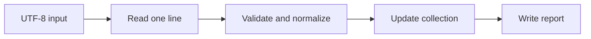

# 13 · Collections Framework & File I/O

[Course home](../README.md) · [Progress](../PROGRESS.md) · [← Abstraction & Interfaces](../12-Abstraction-and-Interfaces/README.md)

**Choose a data structure, process records, and preserve the result.**

Riara Week 10 · Prerequisites: arrays, objects, exceptions and interfaces.

[Source library](sources/README.md) · [Practice guide](PRACTICE.md) · [Liang Ch. 19](../00-Course-Info/sources/textbook/chapter-19-generics.md) · [Ch. 20](../00-Course-Info/sources/textbook/chapter-20-lists-stacks-queues-and-priority-queues.md) · [Ch. 21](../00-Course-Info/sources/textbook/chapter-21-sets-and-maps.md)

## Learning goals

- Choose a list, set or map based on the operations needed.
- Use generic types to make element types explicit.
- Explain average and worst-case performance without treating every collection alike.
- Read and write text using an explicit encoding and automatic resource cleanup.
- Define a response to missing files, invalid records and duplicate keys.

## 1. Match the structure to the question

Liang Chapters 20–21 distinguishes a collection of elements from key/value mappings. `Map` is part of the collections framework but is not a subtype of `Collection`.

| Need | Type | Important behaviour |
|---|---|---|
| Ordered sequence with duplicates | `ArrayList<T>` | Fast indexed reads; middle removal shifts elements |
| Membership with no duplicates | `HashSet<T>` | No guaranteed iteration order |
| Unique entries in insertion order | `LinkedHashSet<T>` | Predictable iteration order |
| Key to value lookup | `HashMap<K,V>` | One value per key; replacement on repeated `put` |
| Keys in sorted order | `TreeMap<K,V>` | Ordering determines key equivalence |
| First-in-first-out queue | `ArrayDeque<T>` | Add at the tail, remove at the head |

```java
java.util.List<String> names = new java.util.ArrayList<>();
names.add("Amina");
names.add("Amina");
java.util.Set<String> unique = new java.util.HashSet<>(names);
System.out.println(names.size());  // 2
System.out.println(unique.size()); // 1
```

Generics allow the compiler to check types before execution. Use `List<Integer>` rather than a raw `List`; primitive types such as `int` cannot be generic type arguments. Autoboxing supplies wrapper values, but unboxing a null `Integer` throws `NullPointerException`.

## 2. Performance needs a named operation

| Operation | Typical cost | Qualification |
|---|---|---|
| `ArrayList.get(index)` | O(1) | Valid index |
| `ArrayList.add(value)` at end | Amortized O(1) | An individual resize is O(n) |
| `ArrayList.contains(value)` | O(n) | May scan every element |
| Hash-based add/contains/get | Expected O(1) | Depends on hashing and collisions |
| `TreeMap` get/put | O(log n) | Maintains sorted keys |

The Week 10 summary simplifies hash lookup to O(1). Treat that as expected performance, not an unconditional worst-case guarantee. A structure should meet correctness requirements before speed becomes the deciding factor.

Hash collections rely on consistent `equals` and `hashCode`: equal objects must have equal hash codes. Avoid changing fields involved in equality while an object is stored as a hash key.

## 3. From a file to useful records



Liang §12.11 covers text input/output; Chapter 17 distinguishes binary I/O. Text encoding maps characters to bytes. Binary formats require agreement about field types and ordering; changing a file extension does not convert a format.

Relative paths are resolved against the process working directory. If you run from the repository root, `input.txt` means a file at the root, not automatically beside the Java class.

## 4. Complete example: count attendance names

This program trims surrounding spaces, skips blank lines and counts exact, case-sensitive names. A `TreeMap` produces a sorted report. It refuses to overwrite an existing output file, so a previous report is not silently lost.

```java
import java.io.BufferedReader;
import java.io.BufferedWriter;
import java.io.IOException;
import java.nio.charset.StandardCharsets;
import java.nio.file.Files;
import java.nio.file.Path;
import java.nio.file.Paths;
import java.nio.file.StandardOpenOption;
import java.util.Map;
import java.util.TreeMap;

public class AttendanceReport {
    public static void main(String[] args) throws IOException {
        if (args.length != 2) {
            System.out.println("Usage: AttendanceReport <input> <new-output>");
            return;
        }
        Path input = Paths.get(args[0]);
        Path output = Paths.get(args[1]);
        Map<String, Integer> counts = new TreeMap<>();
        try (BufferedReader reader = Files.newBufferedReader(input, StandardCharsets.UTF_8)) {
            String line;
            while ((line = reader.readLine()) != null) {
                String name = line.trim();
                if (!name.isEmpty()) counts.merge(name, 1, Integer::sum);
            }
        }
        try (BufferedWriter writer = Files.newBufferedWriter(output, StandardCharsets.UTF_8,
                StandardOpenOption.CREATE_NEW, StandardOpenOption.WRITE)) {
            for (Map.Entry<String, Integer> entry : counts.entrySet()) {
                writer.write(entry.getKey() + ": " + entry.getValue());
                writer.newLine();
            }
        }
    }
}
```

Run [the provided example](examples/AttendanceReport.java) from the repository root:

```powershell
java 13-Collections-Framework-and-File-IO/examples/AttendanceReport.java 13-Collections-Framework-and-File-IO/examples/attendance.txt attendance-report.txt
```

For the supplied input the report is:

```text
Amina: 2
Brian: 1
```

Both resources close automatically. `throws IOException` deliberately reports failure to the caller; a user-facing application should catch it at its interface boundary and provide an actionable message. The input is processed line by line, while the map uses memory proportional to the number of distinct names.

## 5. Failure cases to design deliberately

| Case | Decision to make |
|---|---|
| Missing input | Report the missing path; do not invent records |
| Empty file | Produce an empty report or explain no data |
| Repeated record | Count, reject or replace according to the requirements |
| Invalid numeric field | Reject the row with its line number or stop the import |
| Existing output | Refuse, append or overwrite explicitly |
| Failure during writing | A partial file may remain; production systems may write a temporary file then replace |

Do not remove elements from a collection directly inside a for-each loop over that same collection. Use an iterator's supported removal operation or an appropriate bulk operation such as `removeIf`.

## Check your understanding

1. Why does a set lose the occurrence count?
2. Why would a `HashMap` report need a separate sorting step?
3. Does try-with-resources catch an exception?
4. Why can a mutable map key become difficult to find?

<details>
<summary>Answers</summary>

1. A set stores membership, so duplicate insertions do not add another element.
2. Its iteration order is unspecified; sorting keys makes the report predictable.
3. No. It guarantees resource closing under normal exception propagation; handling or declaration is still required.
4. Changing equality/hash fields can place its effective hash in a different bucket from the one where it was stored.

</details>

## Ready to move on?

- [ ] I can justify a collection using its required operations.
- [ ] I can explain generic types and equality requirements.
- [ ] I have tested normal, empty, missing-input and existing-output cases.
- [ ] I have completed the [practice ladder](PRACTICE.md).
